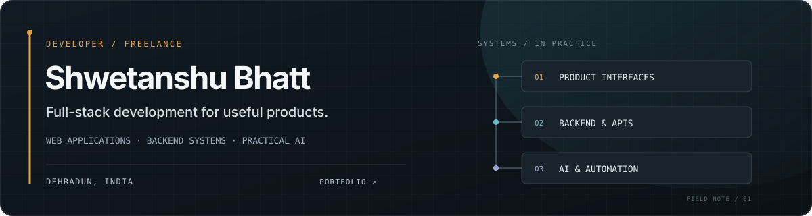

  

  <a href="https://shwetanshubhatt.sifakalabs.in/">Portfolio</a> ·
  <a href="https://www.linkedin.com/in/shwetanshu-bhatt-082167257/">LinkedIn</a>

## What I build

I’m a freelance full-stack developer building web applications, backend systems, and practical AI workflows for startups and businesses. I care about clear user experiences and dependable systems that work beyond the happy path.

## Selected work

<table>
  <tr>
    <td width="50%" valign="top">
      <strong><a href="https://github.com/Shwetanshu-Bhatt/StudySync">StudySync</a></strong> 
      Learning platform for academic resources and real-time communication.
    </td>
    <td width="50%" valign="top">
      <strong><a href="https://lahitanimalwelfaregroup.com">LAHIT Animal Welfare</a></strong> 
      Community platform for rescue reports, adoption, volunteer coordination, and support across Uttarakhand.
    </td>
  </tr>
  <tr>
    <td colspan="2" valign="top">
      <strong><a href="https://shwetanshubhatt.sifakalabs.in/#projects">QA Engine</a></strong> 
      Automated technical question generation and validation.
    </td>
  </tr>
</table>

## Focus

<code>Full-stack web apps</code> <code>Backend &amp; APIs</code> <code>PostgreSQL</code> <code>AI integrations</code> <code>Automation</code>

## Let’s connect

For freelance enquiries, visit my <a href="https://shwetanshubhatt.sifakalabs.in/">portfolio</a> or connect on <a href="https://www.linkedin.com/in/shwetanshu-bhatt-082167257/">LinkedIn</a>.
